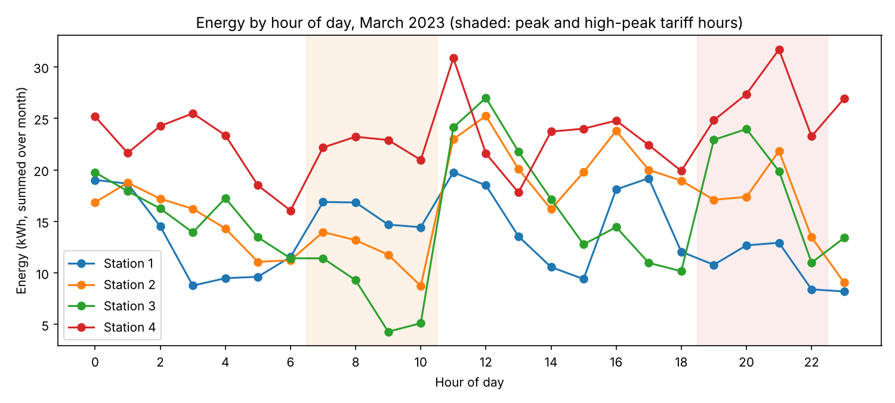
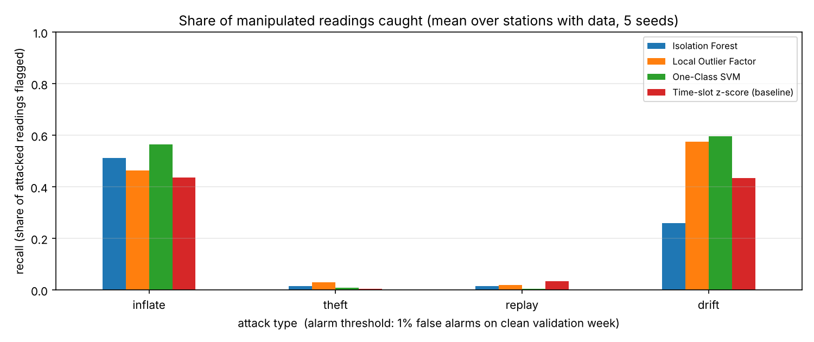

# EV Charging Station Analytics from 5G Smart-Meter Data

Data analytics for four public EV charging stations on the IIT Hyderabad campus, using 15-minute readings from 5G smart meters (March 2023).
The pipeline turns raw meter exports into daily and hourly load profiles, time-of-day (TOD) tariff costs, charging-session estimates and short-term load forecasts.

This repository covers the **data analytics** part of the work (Chapter 2 of the M.Tech thesis). The solar PV design, charging schedule and financial analysis in the thesis were done with simulation and spreadsheet tools and are not included here.

This code accompanies:

> **Adhik S**, V. Cherala, A. Ghosh and P. K. Yemula, "Smart Charging Station Infrastructure: A Data-Driven Approach to EV Charging Station Management," *IEEE National Power Systems Conference (NPSC)*, IIT Indore, 2024. [doi:10.1109/NPSC61626.2024.10986894](https://doi.org/10.1109/NPSC61626.2024.10986894)
>
> **Adhik S**, V. Cherala, A. Ghosh and P. K. Yemula, "Electric Vehicle Charging Station Data Analytics Using 5G Smart Meter," SSRN preprint, 2024. [doi:10.2139/ssrn.4812342](https://doi.org/10.2139/ssrn.4812342)



## Key results (March 2023)

| | Station 1 | Station 2 | Station 3 | Station 4 | All |
|---|---:|---:|---:|---:|---:|
| Total energy (kWh) | 328.70 | 399.22 | 369.74 | 562.90 | **1,660.56** |
| Mean daily energy (kWh) | 10.60 | 12.88 | 11.93 | 18.16 | 53.57 |
| Share of energy in off-peak hours (22:00–07:00) | 32.9% | 32.1% | 36.4% | 36.4% | 34.7% |
| Electricity cost, utility TOD tariff (INR) | 2,291.89 | 2,770.31 | 2,550.67 | 3,908.76 | 11,521.63 |
| *Cost as published in the paper (INR)* | *2,331.81* | *2,819.69* | *2,595.51* | *3,987.40* | *11,734.41* |
| Charging sessions (approx., ≥ 0.25 kWh) | 98 | 138 | 134 | – | – |

Station 4 (meter IHM10050180) is included only through daily and hourly totals, because its raw meter file is not in this repository. Session counts are close to the thesis figures (96, 133, 123); the small differences come from how data gaps are handled.

The published costs used slightly different tariff hours from the paper's own tariff table (see [Changes](#changes-from-the-original-thesis-notebooks)). With the original hours, this code reproduces the paper's Tables II and III exactly.

**Main findings**

- About **28%** of all charging energy falls in the peak and high-peak tariff hours (07:00–11:00 and 19:00–22:00). This is the share that load shifting or TOD pricing could target.
- Demand rises sharply at **11:00** at every station, and at three of the four stations again in the **evening (19:00–22:00)**.
- Weekday and weekend daily energy are **not significantly different** at any of the four stations (Welch's t-test on daily totals, p > 0.15).
- Stations 1 and 3 have **multi-day zero or near-zero energy periods** (24–28 March and 25–31 March). These look like outages or chargers taken out of service, and they affect monthly averages.
- Energy totals from the 15-minute interval method agree with the meter's own 30-minute block-load profile to within 0.5 kWh per station.

## Extension (2026): can simple detectors spot manipulated meter readings?

This part is **not** in the thesis or the paper. It is a later experiment on the same data: inject synthetic cyber-attacks into the meter readings and test whether standard unsupervised anomaly detectors catch them.

**Short answer:** large changes to single readings and slow drifts are caught about half the time. Under-reporting (energy theft) and replayed genuine data are almost never caught. Doing better needs more than one meter's own readings.

**Attacks** (`src/evcs/attacks.py`), each injected separately into the test period:

| Attack | What it does |
|---|---|
| inflate | 10% of non-zero readings multiplied by 1.5–3 (over-billing) |
| theft | 10% of non-zero readings multiplied by 0.1–0.5 (under-reporting) |
| replay | 96 consecutive readings (one day) replaced by genuine readings from the training period |
| drift | an offset growing by 0.005 kWh per reading added over two days (tampered or miscalibrated meter) |

**Protocol** (`src/evcs/anomaly.py`). No information about the attacks is used to train or tune any detector.
- Train on 1–14 March (clean). Set each detector's alarm threshold so that 1% of readings in a clean validation week (15–21 March) raise an alarm. Test on 22–31 March with attacks injected.
- Nine features, using only current and past readings: energy, change from last reading, 1-hour and 4-hour rolling statistics, difference from the typical energy for that time of day, difference from the same time yesterday, and time of day.
- Detectors: Isolation Forest, Local Outlier Factor, One-Class SVM, and a simple baseline (distance from the typical reading for that time slot).
- All four stations, 5 random seeds each.

**Recall** (share of attacked readings flagged), mean over stations and seeds:

| Detector | inflate | theft | replay | drift |
|---|---:|---:|---:|---:|
| Time-slot z-score (baseline) | 0.44 | 0.01 | 0.03 | 0.43 |
| Isolation Forest | 0.51 | 0.01 | 0.02 | 0.26 |
| Local Outlier Factor | 0.46 | 0.03 | 0.02 | 0.57 |
| One-Class SVM | **0.57** | 0.01 | 0.01 | **0.60** |

Full numbers (precision, F1, ROC-AUC, false-alarm rate, per station) are in `results/tables/attack_detection_*.csv`.



**What this shows**
- **The simple baseline is competitive.** On inflation and drift it is close to the machine-learning detectors, and it has the lowest false-alarm rate.
- **Theft and replay are close to invisible** to any detector that only looks at one meter's own readings. Scaled-down charging still looks like normal partial charging, and replayed data *is* normal data. Catching these needs a second source, for example the charger's own logs, a feeder-level meter, or cross-checks between stations.
- **False alarms rise on new data.** Thresholds set for 1% false alarms in the validation week gave 4–8% for LOF and One-Class SVM in the test week, because charging patterns shift from week to week (Stations 1 and 3 also have multi-day outages in the test period).
- **Isolation Forest ranks theft better than its recall suggests** (ROC-AUC 0.80), but at a 1% false-alarm budget it still flags almost none of it.

**A note on an earlier version.** My first notebook on this reported F1 = 0.79 for Isolation Forest. That number was not valid, for two reasons:
1. The data step kept both the import *and* the export energy registers, so most "energy" values were jumps between the two registers (mean about 1,500 kWh per interval; the real maximum is 2.7 kWh).
2. The detector was trained and scored on the same data, with its expected anomaly share set to exactly the true attack rate (10%).

On the correct data, that original setup gives F1 = 0.65. The corrected protocol gives F1 = 0.52 (precision 0.84, recall 0.37) on the same kind of attack (`results/tables/attack_detection_protocol_comparison.csv`). The two are not directly comparable, since the original setup flags 10% of readings and the corrected one about 1%, but only the corrected one can be used on data where the attack rate is unknown.

## Repository structure

```
├── src/evcs/              # all analysis logic
│   ├── config.py          # station-to-meter mapping, study period, paths
│   ├── io.py              # read meter exports, build interval energy
│   ├── tariff.py          # TOD tariff bands and cost calculation
│   ├── analysis.py        # daily/hourly profiles, statistics, sessions
│   ├── forecast.py        # hour-ahead forecasting with baselines
│   ├── attacks.py         # synthetic cyber-attacks on meter readings (2026 extension)
│   ├── anomaly.py         # features and anomaly detectors (2026 extension)
│   └── plots.py           # figures
├── scripts/run_analysis.py  # regenerates everything in results/
├── scripts/run_attack_detection.py  # attack-detection experiment (needs raw data)
├── notebooks/01_station1_walkthrough.ipynb
├── data/
│   ├── raw/               # meter exports (not public, see data/README.md)
│   └── processed/         # daily and hour-of-day totals for all 4 stations
├── results/
│   ├── figures/
│   └── tables/
└── tests/                 # unit tests on synthetic data
```

## How to run

```bash
git clone https://github.com/adhiksuresh/ev-charging-station-analytics.git
cd ev-charging-station-analytics
pip install -r requirements.txt

python scripts/run_analysis.py   # writes results/figures and results/tables
python scripts/run_attack_detection.py   # attack-detection extension (needs raw data, ~20 s)
pytest                           # runs the unit tests
```

Without the raw meter files, the script still produces the all-station figures from `data/processed/`. To get the per-station analysis, place the raw exports in `data/raw/` (see [data/README.md](data/README.md)).

## Method

1. **Interval energy.** The meter records a cumulative import-energy register (OBIS `1-0:1.8.0`) about every 15 minutes. Energy per interval is the difference between consecutive readings. Negative jumps (meter resets) are set to zero.
2. **Tariff cost.** Each interval is assigned to a TOD band and priced:

   | Band | Hours | Utility TOD (INR/kWh) | Retail scenario A | Retail scenario B |
   |---|---|---:|---:|---:|
   | Off-peak | 22:00–07:00 | 6 | 12 | 10 |
   | Peak | 07:00–11:00 | 8 | 18 | 20 |
   | Mid-peak | 11:00–19:00 | 7 | 14 | 15 |
   | High-peak | 19:00–22:00 | 8 | 20 | 25 |

   Hours and utility rates follow the tariff table in the thesis and paper. Retail scenario A matches the paper's EV TOD rates.

3. **Statistics.** Daily summary statistics, weekday vs weekend (Welch's t-test on daily totals), holidays (8 and 22 March) vs other days, and days more than one standard deviation from the mean.
4. **Sessions.** A charging session is a run of consecutive intervals with energy above zero, ending at an idle interval or a data gap over 20 minutes. Sessions below 0.25 kWh are dropped as noise.
5. **Forecasting.** Hour-ahead energy forecasts with XGBoost (calendar, lag and rolling features), compared against persistence and seasonal-naive baselines on the last 20% of the month.

## Limitations

- **One month of data.** This is enough for descriptive load profiles. It is not enough for reliable forecasting: on the held-out data, XGBoost does not beat the simple persistence baseline (see `results/tables/forecast_metrics.csv`).
- **Session counts are approximate.** With 15-minute data, back-to-back vehicles look like one session, so the counts are a lower bound.
- **Missing data.** Data ends at about 15:00 on 31 March, and each station has 11–15 gaps longer than 20 minutes.

## Changes from the original thesis notebooks

This repository is a cleaned rebuild of the original analysis notebooks. The monthly energy totals are unchanged. These issues were fixed:

| Issue in original notebooks | Effect | Fix |
|---|---|---|
| Filtering on `Unit == "kWh"` kept both the import (`1-0:1.8.0`) and export (`1-0:2.8.0`) registers | Totals were correct (export is always 0), but half the rows were zero-valued export readings, which distorted per-interval averages, the t-test and the forecasting inputs | Filter on the import OBIS code only |
| The code's tariff hours differed from the published tariff table (off-peak 22:00–07:00, high-peak 19:00–22:00). The code used off-peak 23:00–06:00, so 06:00–07:00 and 22:00–23:00 were charged at high-peak rates | Published monthly cost about 1.8% too high (INR 11,734.41 → 11,521.63 for all four stations) | Bands follow the published table. The old bands are kept as `ORIGINAL_NOTEBOOK_BANDS`, and reproduce the paper's Tables II and III exactly |
| Rolling-mean forecast features included the current hour | The reported R² ≈ 0.93 was inflated, because the model could see the value it was predicting | Rolling features use only past hours |
| Weekday/weekend t-test run on individual 15-minute readings | Correlated samples overstate significance | Test on daily totals |
| Station 1 used retail scenario A, Stations 2–4 used scenario B | Stations were not comparable | Both scenarios computed for every station |

## Citation

If you use this code, please cite the NPSC 2024 paper above. GitHub's "Cite this repository" button uses [CITATION.cff](CITATION.cff).

## M.Tech thesis

The full thesis is in [`docs/MTech_thesis_IITH_2024.pdf`](docs/MTech_thesis_IITH_2024.pdf) (IIT Hyderabad, July 2024). It covers more than this repository's code:

| Chapter | Content | In this repository? |
|---|---|---|
| 2. EV charging station data analytics | Smart-meter data processing, load profiles, tariff costs, sessions | Yes: `src/evcs/` reproduces this chapter |
| 3. Integration of solar into the EV charging station | Design and simulation of a 30 kW grid-connected rooftop PV system | No (simulation and design tools) |
| 4. EV charging station scheduling | Charging schedule, bill savings with solar, CO2 estimates | No (spreadsheet analysis) |

The cost figures in the thesis use the original tariff hours. See "Changes from the original thesis notebooks" above for the small difference this makes.

## Acknowledgements

Smart Grid Lab, Department of Electrical Engineering, IIT Hyderabad. Supervisor: Dr. P. K. Yemula.

## License

Code: [MIT](LICENSE). The meter data is not covered by this license (see [data/README.md](data/README.md)).
